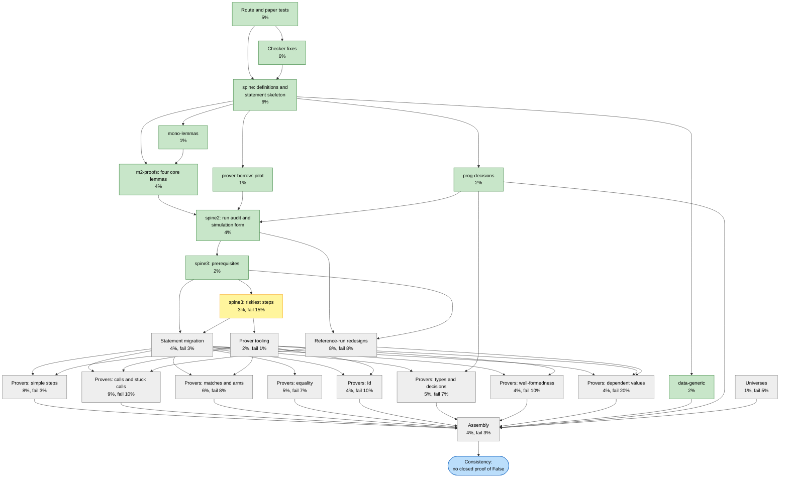

# 32. The consistency proof as work units: done and to do

Written 2026-11-19; last updated the same day, after `spine3`'s first milestone (spine at b6a65b5e). A map of the whole consistency effort (Target A of docs/18), one row per unit of work of roughly one agent's size. The plan itself is docs/18; the detailed record of the Lean development is docs/31 on the `spine` branch.

The numbers are estimates by the orchestrating session, not measurements.

- **P(failure)** is the chance the unit's claim turns out false in spirit: the checker's rules have to change, or the proof architecture does. A statement that has to be tweaked while staying correct in spirit, with the architecture going ahead, counts as success. Most refutations so far have been of that kind.
- **Time** is the unit's share of all the effort the consistency proof needs. The column sums to 100% over both tables: about 33% is done and 67% remains.

## Done (33%)

| Work unit | What it contains | P(failure) | Time |
|---|---|---|---|
| Route and paper tests (`model-slice`, `model-slice-lean`, and the work behind docs/23, 25, 26 and 27) | Chose the meaning-preservation route. Showed the set model exists on a slice. Showed each old proof of `False` is a failed step. Audited every checker decision. Worked a higher-order slice. | done | 5% |
| Checker fixes (`etaboom-fix`, `bot-conv-fix`, `pisort-fix`, the join-drop change, and three later fixes) | Fixed accepted programs that proved `False` or went wrong, so that the theorem is true of the checker. | done | 6% |
| `spine` (first lead) | Lean definitions of a state's meaning and the reference run. Skeleton of 73 step statements and the final assembly, all unproved. | done; many statements later found false | 6% |
| `data-generic` | The model of user-defined data types, for any declaration. | done | 2% |
| `mono-lemmas` | Monotonicity lemmas for the reference run. | done | 1% |
| `prog-decisions` | The meaning of a whole program, and the checker's syntactic decisions packaged for the model. Found the function-sort bug. | done | 2% |
| `m2-proofs` | The four core lemmas: substitution and congruence, for values and for runs. No `sorry`. | done | 4% |
| `prover-borrow` | Pilot prover on the borrow steps. It tested the statement form, not the proofs. | done as a pilot; proofs not closed | 1% |
| `spine2` | Compared the reference run with the checker case by case: 16 differences, 11 fixed. Refuted the old statement form and introduced the simulation form. | done | 4% |
| `spine3`: prerequisites | The two lemmas the migration waited on. Both exposed a fault in the simulation relation itself: it did not compare function shapes, and it asked for a renaming of labels that cannot exist after a private copy. Both repaired, and the relation is proved to survive a private copy. Well-formedness gained a clause: no stored type or record holds a loan. Found three more differences between the reference run and the checker. | done | 2% |

Not counted, because they are off the consistency path: `id-audit` and `subst-survey` (the dropped `Id` target), `runtime-j` (type safety), `paper-claims` and `docs18-sync` (document upkeep).

## To do (67%)

| Work unit | What it contains | P(failure) | Time |
|---|---|---|---|
| `spine3`: riskiest steps (running) | Prove or refute the two riskiest steps in the new form: the drop at the join, and `Id`'s observation. | 15% | 3% |
| Statement migration | Move the remaining ~70 step statements to the simulation form, one file at a time. | 3% | 4% |
| Reference-run redesigns | The open differences from the checker, the comparison at other futures, and restricting the claim about untyped runs. The differences that matter most: the result of a call loses its function shape, so the reference cannot call a function returned by a call, or a parameter whose type is computed by a call (`f : Fn(Nat)`, the ordinary predicate idiom, which the checker accepts); and a proof has no type in the reference, so a constructor whose type parameter is solved by a proof field fails. Until these land, the mechanised theorem is false on such programs. A design for the call cases exists (docs/31, D22). | 8% | 8% |
| Prover tooling | A shared library about positions in a state, and the standard prover brief. | 1% | 2% |
| Provers: simple steps | Borrow primitives, substitution, plain evaluation, tail forms. | 3% | 8% |
| Provers: calls and stuck calls | Calls, closing a stuck call into a sealed program, re-running one, and the label-renaming lemma. | 10% | 9% |
| Provers: matches and arms | Splitting on an unknown, leaving an arm, and the drop at the join. | 8% | 6% |
| Provers: equality | Conversion, `Eq` and `J` computing, and rewriting. | 7% | 5% |
| Provers: `Id` | `Id` observes every place either side can write. | 10% | 4% |
| Provers: types and decisions | The model reads types and syntactic decisions the same way as the checker (18 statements). | 7% | 5% |
| Provers: well-formedness | The borrow discipline is preserved by every step. | 10% | 4% |
| Provers: dependent values | Membership is restored when a value whose type depends on its own fields is made whole again. | 20% | 4% |
| Assembly | The top-level theorems, closing the induction, and the data model for a whole program. | 3% | 4% |
| Universes | Deciding which statement Lean can prove over all programs. | 5%. The uniform statement may be unprovable in Lean (about 40%); bounded levels then replaces it, which is a tweak. | 1% |

## Reading the risk column

A unit fails only if its claim is false in spirit. Having to restate a lemma, add a hypothesis or repair a definition of the model is not a failure, and has been the usual outcome of a refutation so far.

A failure of one unit rarely ends the project either. It usually means a fix to the checker, then continuing, as with the accepted proofs of `False` found and fixed earlier.

- **Chance at least one remaining unit fails**, so that the checker or the architecture has to change somewhere: about 65%. The rows are not independent (the drop at the join and `Id` each appear in two rows), so this is less than the rows multiplied out.
- **Chance the route itself fails**, so that meaning preservation has to be abandoned: about 10%.
- **Riskiest rows:** dependent values, where one of the old `False` proofs lived; then `spine3`'s two steps, the drop at the join and `Id`.

## Dependencies

An arrow from X to Y means Y builds on X. Green is done, yellow is running, grey is to do. The eight prover units are independent of each other: each proves its steps from the shared induction hypothesis, so they can run in parallel once the statements are migrated.

