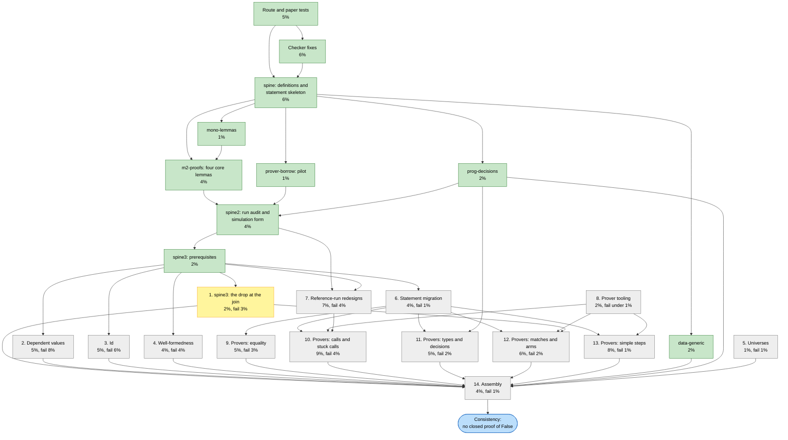

# 32. The consistency proof as work units: done and to do

Written 2026-11-19; last updated the same day, after `spine3`'s first milestone (spine at b6a65b5e). A map of the whole consistency effort (Target A of docs/18), one row per unit of work of roughly one agent's size. The plan itself is docs/18; the detailed record of the Lean development is docs/31 on the `spine` branch.

The numbers are estimates by the orchestrating session, not measurements.

- **P(failure)** is the chance the unit cannot be finished on the current plan: it needs a language feature redesigned, or a different proof architecture. Two outcomes count as success, because the work continues as planned after them. One is a tweaked statement: a lemma restated, a hypothesis added or a model definition repaired, the claim staying true in spirit. The other is a local checker fix: one rule tightened so that a class of wrongly accepted programs is rejected, as when a stuck block's arm was forbidden to return a borrow of a place the block takes by move.
- **Time** is the unit's share of all the effort the consistency proof needs. The column sums to 100% over both tables: about 33% is done and 67% remains.

## Done (33%)

| Work unit | What it contains | P(failure) | Time |
|---|---|---|---|
| Route and paper tests (`model-slice`, `model-slice-lean`, and the work behind docs/23, 25, 26 and 27) | Chose the meaning-preservation route. Showed the set model exists on a slice. Showed each old proof of `False` is a failed step. Audited every checker decision. Worked a higher-order slice. | done | 5% |
| Checker fixes (`etaboom-fix`, `bot-conv-fix`, `pisort-fix`, the join-drop change, and three later fixes) | Fixed accepted programs that proved `False` or went wrong, so that the theorem is true of the checker. | done | 6% |
| `spine` (first lead) | Lean definitions of a state's meaning and the reference run. Skeleton of 73 step statements and the final assembly, all unproved. | done; many statements later found false | 6% |
| `data-generic` | The model of user-defined data types, for any declaration. | done | 2% |
| `mono-lemmas` | Monotonicity lemmas for the reference run. | done | 1% |
| `prog-decisions` | The meaning of a whole program, and the checker's syntactic decisions packaged for the model. Found the function-sort bug. | done | 2% |
| `m2-proofs` | The four core lemmas: substitution and congruence, for values and for runs. No `sorry`. | done | 4% |
| `prover-borrow` | Pilot prover on the borrow steps. It tested the statement form, not the proofs. | done as a pilot; proofs not closed | 1% |
| `spine2` | Compared the reference run with the checker case by case: 16 differences, 11 fixed. Refuted the old statement form and introduced the simulation form. | done | 4% |
| `spine3`: prerequisites | The two lemmas the migration waited on. Both exposed a fault in the simulation relation itself: it did not compare function shapes, and it asked for a renaming of labels that cannot exist after a private copy. Both repaired, and the relation is proved to survive a private copy. Well-formedness gained a clause: no stored type or record holds a loan. Found three more differences between the reference run and the checker. | done | 2% |

Not counted, because they are off the consistency path: `id-audit` and `subst-survey` (the dropped `Id` target), `runtime-j` (type safety), `paper-claims` and `docs18-sync` (document upkeep).

## To do (67%)

Rows are in the order the units will be taken: the running unit first, then the highest P(failure) for the least time, so that risk comes forward. Where a risky unit needs something built first, that work moves ahead with it and is counted in its row. The three units every remaining prover needs (migration, redesigns, tooling) come before the provers that need them.

| # | Work unit | What it contains | P(failure) | Time |
|---|---|---|---|---|
| 1 | `spine3`: the drop at the join (running) | Prove or refute, in the simulation form, that dropping at the end of a match every place some arm moved keeps the relation. | 3% | 2% |
| 2 | Dependent values | Give a partly opened dependent value a meaning in the reference run, which it lacks today, so the step can be stated. Then prove or refute that membership is restored when a value whose type depends on its own fields is made whole again, under every future of the parts still lent. One of the old proofs of `False` lived here. | 8% | 5% |
| 3 | `Id` | `Id` observes every place either side can write, and its computing to a conjunction over those places keeps the meaning. | 6% | 5% |
| 4 | Well-formedness | The borrow discipline is preserved by every step, including the new clause that no stored type or record holds a loan. | 4% | 4% |
| 5 | Universes | Deciding which statement Lean can prove over all programs. The bounded-levels statement is what the Lean development already builds; the open part is whether a uniform statement is provable (about 40% that it is not, which is a tweak, not a failure). | 1% | 1% |
| 6 | Statement migration | Move the remaining step statements to the simulation form, one file at a time. A unit taken before this row migrates its own statements. | 1% | 4% |
| 7 | Reference-run redesigns | The remaining open differences from the checker, the comparison at other futures, and restricting the claim about untyped runs. The differences that matter most: the result of a call loses its function shape, so the reference cannot call a function returned by a call, or a parameter whose type is computed by a call (`f : Fn(Nat)`, the ordinary predicate idiom, which the checker accepts); and a proof has no type in the reference, so a constructor whose type parameter is solved by a proof field fails. Until these land, the mechanised theorem is false on such programs. A design for the call cases exists (docs/31, D22). | 4% | 7% |
| 8 | Prover tooling | A shared library about positions in a state, and the standard prover brief. | under 1% | 2% |
| 9 | Provers: equality | Conversion, `Eq` and `J` computing, and rewriting. | 3% | 5% |
| 10 | Provers: calls and stuck calls | Calls, closing a stuck call into a sealed program, re-running one, and the label-renaming lemma. | 4% | 9% |
| 11 | Provers: types and decisions | The model reads types and syntactic decisions the same way as the checker (18 statements). | 2% | 5% |
| 12 | Provers: matches and arms | Splitting on an unknown and leaving an arm. | 2% | 6% |
| 13 | Provers: simple steps | Borrow primitives, substitution, plain evaluation, tail forms. | 1% | 8% |
| 14 | Assembly | The top-level theorems, closing the induction, and the data model for a whole program. | 1% | 4% |

## Reading the risk column

A unit fails only if it cannot be finished on the current plan. Restating a lemma, repairing a model definition and tightening one checker rule are all successes: the proof goes ahead as planned after each. Nearly every refutation so far has ended in one of the first two, and the accepted proofs of `False` found earlier ended in the third.

- **Chance at least one remaining unit needs a local checker fix** (a success): about 65%.
- **Chance at least one remaining unit fails**, so that a feature is redesigned or part of the proof is re-planned: about 30%. The rows are not independent (a fault in the simulation relation would hit several at once), so this is less than the rows multiplied out.
- **Chance the route itself fails**, so that meaning preservation has to be abandoned: about 7%.
- **Riskiest rows:** dependent values, where one of the old `False` proofs lived; then `Id` and the drop at the join. The drop at the join is itself the result of an earlier redesign of this size.

## Dependencies

An arrow from X to Y means Y builds on X. Green is done, yellow is running, grey is to do. The diagram shows only what builds on what; the order the units are taken in is the table's. Units 2 to 5 need only the repaired simulation relation, which is why they can come before the migration.

