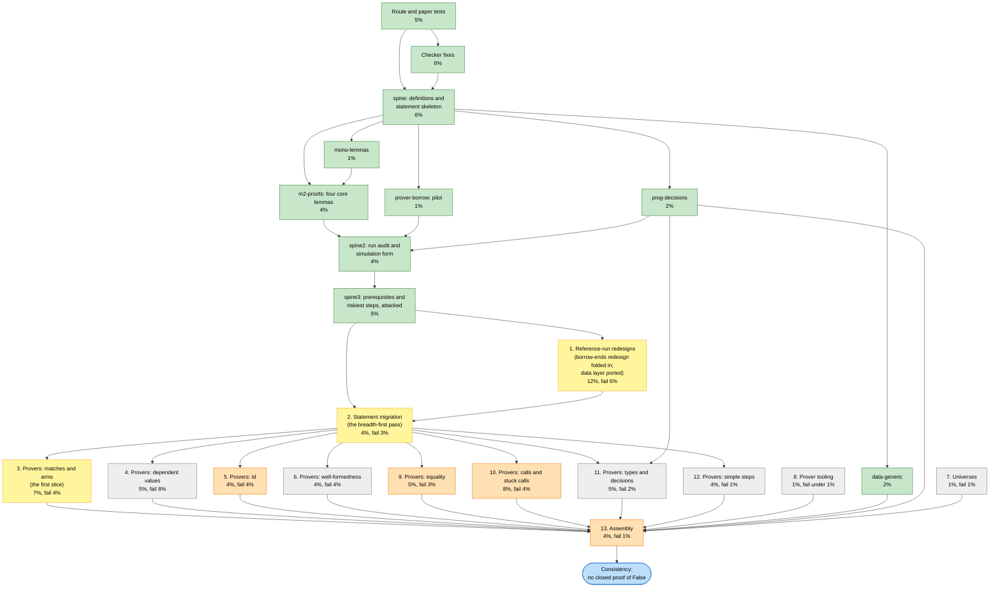

# 32. The consistency proof as work units: done and to do

Written 2026-11-19; last updated 2026-11-20, late evening (tables, progress paragraph and diagram brought into line with each other). A map of the whole consistency effort (Target A of docs/18), one row per unit of work of roughly one agent's size. The plan itself is docs/18; the detailed record of the Lean development is docs/31 on the `spine` branch.

The numbers are estimates by the orchestrating session, not measurements.

- **P(failure)** is the chance the unit cannot be finished on the current plan: it needs a language feature redesigned, or a different proof architecture. Two outcomes count as success, because the work continues as planned after them. One is a tweaked statement: a lemma restated, a hypothesis added or a model definition repaired, the claim staying true in spirit. The other is a local checker fix: one rule tightened so that a class of wrongly accepted programs is rejected, as when a stuck block's arm was forbidden to return a borrow of a place the block takes by move.
- **Time** is the unit's share of all the effort the consistency proof needs. The column sums to 100% over both tables: about 36% is done and 64% remains.
- **The set of rows is fixed.** When a piece of work turns out bigger than estimated, or needs a repair or a fix nobody planned, that work is folded into the row it was done in service of, and the row's time and risk are re-estimated. No row is added for it.

## Done (36%)

| Work unit | What it contains | P(failure) | Time |
|---|---|---|---|
| Route and paper tests (`model-slice`, `model-slice-lean`, and the work behind docs/23, 25, 26 and 27) | Chose the meaning-preservation route. Showed the set model exists on a slice. Showed each old proof of `False` is a failed step. Audited every checker decision. Worked a higher-order slice. | done | 5% |
| Checker fixes (`etaboom-fix`, `bot-conv-fix`, `pisort-fix`, the join-drop change, and three later fixes) | Fixed accepted programs that proved `False` or went wrong, so that the theorem is true of the checker. | done | 6% |
| `spine` (first lead) | Lean definitions of a state's meaning and the reference run. Skeleton of 73 step statements and the final assembly, all unproved. | done; many statements later found false | 6% |
| `data-generic` | The model of user-defined data types, for any declaration. | done | 2% |
| `mono-lemmas` | Monotonicity lemmas for the reference run. | done | 1% |
| `prog-decisions` | The meaning of a whole program, and the checker's syntactic decisions packaged for the model. Found the function-sort bug. | done | 2% |
| `m2-proofs` | The four core lemmas: substitution and congruence, for values and for runs. No `sorry`. | done | 4% |
| `prover-borrow` | Pilot prover on the borrow steps. It tested the statement form, not the proofs. | done as a pilot; proofs not closed | 1% |
| `spine2` | Compared the reference run with the checker case by case: 16 differences, 11 fixed. Refuted the old statement form and introduced the simulation form. | done | 4% |
| `spine3`: prerequisites and riskiest steps, attacked | The two lemmas the statement migration waited on, then attacks on the two steps judged riskiest, the drop at the join and `Id`. An attack here means reading the statement against the checker from a related state and checking counterexamples in Lean; it is NOT a proof, and both steps are still `sorry`. Found and fixed: five faults of the simulation relation (it did not compare function shapes; it asked for a renaming of labels that cannot exist after a private copy; it compared states by an order where it needed equality; and two more), six faults of the model (among them: a partly moved value was a member of no type; reading one field ended a borrow of another; `Id` compared re-pointed borrows at untyped written values), and statement faults (the `Id` and `Eq` statements were satisfied by any wrong witness). Well-formedness gained a clause: no stored type or record holds a loan. One judgement made by reading was wrong: the gap at the join that was called harmless is where the checker fault of row 1 below was then found. | done; no checker change | 5% |

Not counted, because they are off the consistency path: `id-audit` and `subst-survey` (the dropped `Id` target), `runtime-j` (type safety), `paper-claims` and `docs18-sync` (document upkeep).

## To do (64%)

No step lemma is proved end to end yet (2026-11-20, late evening). The furthest along is the drop at the join: it is proved from the drop of one place, and that one is proved apart from named obligations, of which the bookkeeping is now proved and one typing fact is the real work (see "The two things running in parallel"). Calls, the top-level chain, `Id`, and equality and `J` have their statements in final form and are proved from named pieces, with the model's runs checked in Lean beside the checker's verdicts; the pieces themselves are open. What else is done is definitions, the four core lemmas (re-proved on each rebuild of the model), and attacks that corrected the statements.

**What can depend on what.** Nothing depends on a proof: once a statement is fixed, other work assumes it. Work depends only on definitions and statements. So the two rows that change definitions and statements (1 and 2) come first and everything else builds on them, and no arrow in the diagram leaves a prover row except into the assembly. Among the prover rows the order is a choice, not a dependency: the highest P(failure) for the least time first, so that risk comes forward. Matches and arms leads because it holds the first proof of any step, which is the first real test of the statement form.

| # | Work unit | What it contains | P(failure) | Time |
|---|---|---|---|---|
| 1 | Reference-run redesigns (running) | Making the model's reference run and the checker agree. Folded in, because it is the largest disagreement there was: the checker's borrow-ends redesign. Each run used to discover afresh when a borrow ends, the generic run over-approximating and an instance being precise, which gave three checker faults found on 2026-11-19 (accepted functions whose closed calls fail: `EJ`, `EI`, `G1`, in `ochr/core/probes/static-ends/`) and forced the model to carry a set of early-ended borrows. Now when a borrow ends is a decision every run takes the same way, as Rust does: a call that returns a borrow lends every place it borrowed, and a non-tail match on a known constructor treats outer places as the stuck match would (decision D90, on main since 2026-11-19 at 46dd2d9a; one existing verdict changed, which Rust also rejects). A stuck match now also touches its captures before its arms are checked (D91, on main at 9c78a376), so the generic run and an instance have the same borrows live at every point. The Lean model is rebuilt on the new checker (`spine5`): the reference run ends borrows from a table of lent places and never from meanings. Decided and built on 2026-11-20 (`spine` ffc4458e; built and axiom-checked independently by the orchestrator): the model's data values are self-describing. A constructor value's meaning carries its declaration, its parameters, its constructor and its fields, so the reference finds its way inside a value by reading the value alone, as the checker does and as an element of Lean's set model does. Twice in one evening the old form (an opaque element of a set, decoded with a declaration or a type taken from elsewhere) made the model wrong on an accepted program: two declarations with the same set, and a field whose type's index had been moved. With it a call's result now carries its data type; its function shape is still lost. The reference run's tail-position flag, match entry and capture access are built too (`spine` cf732702), with the checker's decisions made part of the context every step carries. One disagreement was left on purpose: the checker runs a field read as a one-arm match whose entry reads the whole value, where the model reads the field directly. That was removed in the checker (D93, below), not copied into the model; the model is being aligned with it. Built since (`spine` 060a8335, docs/31 D59–D61): types mean codes, as in Lean's own metatheory, so a call's result, a function type computed by a call (`f : Fn(Nat)`, the predicate idiom) and a field keep their structure, and a proof read at a place has its place's type; the model's own run gives the checker's answer on the accepted programs that showed these gaps, and the four core lemmas are re-proved on codes. Found on the way and fixed: every recursive closure meant `err` (D60). A data type's code now names its declaration, parameters and carrier, and fields are read through the data model, so recursive and nested inductives have meanings (`spine` bfc0ad7f, D61; kernel-checked runs on `List` and `Rose` beside the checker's verdicts); the existence of a data model for every accepted program now also owes a reading coherent with it. Still to do here: the comparison at other futures; and restricting the claim about untyped runs. | 6% | 12% |
| 2 | Statement migration | The form every step statement takes. The simulation relation is re-made on the redesign, with no set of early-ended borrows and no witness clause: the same borrows held in the same positions, lent at the same places, readings equal. Proving the first composition changed the form in four ways (a run may start from any log; a step may conclude under an extended context of unknowns; the drop's grain is a hypothesis; scope is preserved along a list). Still to do: the remaining step statements moved onto it: reads, borrows, assignments, access, drops, calls, `J`, closing off and the tail forms. The eval forms, matches, observation and `Eq` were migrated to the earlier relation and are re-stated. | 3% | 4% |
| 3 | Provers: matches and arms | The drop at the join, splitting on an unknown, and leaving an arm. The drop at the join was the first proof attempted of any step; the attempt on the old checker found the fault that led to the redesign in row 1. On the redesigned checker the drop of a list of places is proved from the drop of one place, and that one is proved apart from named obligations: three typing facts (a non-copy data place never reads as a proof), that an access loses no unknown, that the copy decision leaves the state unchanged, and the run context after each step. Proving it changed the checker twice more (the join rejects an arm that moves a place its type does not have; one-constructor matches refine in place) and the model several times. Still to do: those obligations, then splitting on an unknown and leaving an arm. | 4% | 7% |
| 4 | Provers: dependent values | Give a partly opened dependent value a meaning in the reference run, which it lacks today, so the step can be stated. Then prove or refute that membership is restored when a value whose type depends on its own fields is made whole again, under every future of the parts still lent. One of the old proofs of `False` lived here. | 8% | 5% |
| 5 | Provers: `Id` | Prove the corrected statements: `Id` observes every place either side can write, and its computing to a conjunction over those places keeps the meaning. | 4% | 4% |
| 6 | Provers: well-formedness | The borrow discipline is preserved by every step, including the clause that no stored type or record holds a loan. | 4% | 4% |
| 7 | Universes | Deciding which statement Lean can prove over all programs. The bounded-levels statement is what the Lean development already builds; the open part is whether a uniform statement is provable (about 40% that it is not, which is a tweak, not a failure). | 1% | 1% |
| 8 | Prover tooling | A shared library about positions in a state, and the standard prover brief. | under 1% | 1% |
| 9 | Provers: equality | Conversion, `Eq` and `J` computing, and rewriting. | 3% | 5% |
| 10 | Provers: calls and stuck calls | Calls, closing a stuck call into a sealed program, re-running one, and the label-renaming lemma. | 4% | 8% |
| 11 | Provers: types and decisions | The model reads types and syntactic decisions the same way as the checker (18 statements). | 2% | 5% |
| 12 | Provers: simple steps | Borrow primitives, substitution, plain evaluation, tail forms. | 1% | 4% |
| 13 | Assembly | The top-level theorems, closing the induction, and the data model for a whole program. | 1% | 4% |

**Progress inside the to-do rows** (estimated 2026-11-20, late evening; a row moves to the done table only when it is finished). Row 1, reference-run redesigns: nearly all of it (the checker redesign, the model rebuilt on it, coded types, records for reads, the data layer ported to tree values; left: small alignments of the run with the checker that the port and the breadth pass named). Row 2, statement migration: about two thirds (the relation re-made; calls, the top-level chain, `Id`, equality and `J` in final form; splits and worlds, the well-formedness table, closures and recursion, and dependent values still to be attacked). Row 3, matches and arms: about two fifths (the drop at the join proved apart from named obligations; one of them is the slice's typing fact). Rows 5, 9, 10 and 13 (`Id`, equality, calls, assembly): the step follows from named pieces, the pieces are open; about a fifth each. Row 6: invariant clauses are tested on every recorded checker state, none proved preserved. Row 11: one statement (the checker's reading of a type's sort is sound for the model) is being stated by the slice. Rows 4, 7, 8, 12: not started. That is about 19 of the 64 points, so a little over half of the whole effort is done.

## Reading the risk column

A unit fails only if it cannot be finished on the current plan. Restating a lemma, repairing a model definition and tightening one checker rule are all successes: the proof goes ahead as planned after each. Nearly every refutation so far has ended in one of the first two, and the accepted proofs of `False` found earlier ended in the third.

- **Chance at least one remaining unit needs a local checker fix** (a success): about 65%. Found so far, on 2026-11-19: three faults with one root, when a borrow ends. They were answered by the redesign in row 1, which counts as a feature redesign, not a local fix.
- **Chance at least one remaining unit fails**, so that a feature is redesigned or part of the proof is re-planned: about 30%. The rows are not independent (a fault in the simulation relation would hit several at once), so this is less than the rows multiplied out.
- **Chance the route itself fails**, so that meaning preservation has to be abandoned: about 7%.
- **Riskiest rows:** dependent values, where one of the old `False` proofs lived; then matches and arms, because it holds the first step proof: no step has been proved yet, and an earlier pilot under the old statement form closed nothing.

## Is it converging

Asked by the user on 2026-11-20: the effort keeps finding problems and no row of the table closes. This section keeps the evidence in one place so the question is answered by counts, not by feel. Updated at each half-day.

| Period | Checker changes landed | Of those, changing a verdict | Model definitions rebuilt | Simulation relation restated | Steps proved end to end | Areas attacked by proof |
|---|---|---|---|---|---|---|
| 19 Nov 16:30 to 20 Nov 04:00 | 3 (D90, D91, D92) | 1 (D90: three accepted functions that failed when run) | 2 (static lending; self-describing data values) | 2 | 0 | 1 (the join) |
| 20 Nov 04:00 to 16:30 | 6 (D93 to D98) | 3 (D93: two bugs and Rust's disjoint fields; D94: an ill-typed dead arm; D98: nine probe rows) | 3 (coded types; data codes; reads at recorded values) | 2 | 0 | 2 (the join, calls) |

Per area, since the breadth-first pass began (2026-11-20, evening). "Statements false" counts statements found false or empty by the attack.

| Area attacked | Checker faults | Model definitions changed | Relation changed | Statements false | Note |
|---|---|---|---|---|---|
| Calls | 1 (a returned borrow kept its argument's label; fixed as D99, no verdict change) | 1 | 0 | 4 | found by writing the proofs that glue the pieces |
| The data model | 0 | 2 (recursion through nested types; large type parameters) and a redesign, ported on 2026-11-20 (a data value means its own tree; the whole library builds on it, rebuilt and axiom-checked independently; a dropped value is now below the original and a partly moved value is a member in the form first stated, both of which the old layer got the other way; the statement that the type `False` has no member is now proved). The port found one disagreement with the checker: the checker solves a constructor's value parameter from the type of a field (`MkW(t)` with `t : Tag(3)` gives `Wrap(3)`), which the model cannot mirror because it does not treat `Tag` as injective. No program in the suite does this; three constructed ones do. Decided, then revised the same evening: the model is extended to follow the checker here, and the checker stops inferring only function parameters (see the list of design changes) | 0 | 2 (the existence statement is satisfied by a model that ignores the program) | found before anything was built |
| The top-level chain | 0 | 0 | 0 | 2 | the chain closed for a constant and stopped at a function: the context assumed, of the definition being checked, what was to be proved of it. The plan's outer induction on the decreasing argument was missing from the Lean statements; it changes the context every step assumes, not the relation. Built since (2026-11-20, late evening): the context names the definition being checked and assumes of it only its good behaviour on smaller arguments; the chain now closes for a recursive function too, every gap a named statement, and a real recursive definition goes through the induction in Lean's kernel. Building it found no statement false; the data layer then found two of the statements it was asked to supply false as written, with kernel-checked counterexamples before any proof was tried. The serious one: the function's meaning while it is being checked (good only on smaller arguments) is not an element of its function type unless every result type is already known to be inhabited, which is what the induction is proving. Direction set and confirmed against the model's codes the same evening: give that partial meaning a weakened type whose results above the bound are trivially inhabited (the unit type; for a returned borrow, a borrow of unit), so it is an honest element of a function type and is built by the ordinary construction, with no appeal to anything being inhabited. The closure lemmas are proved in the forms that hold; the recursion argument's statements are to be restated on them by the lead |
| `Id` | 0 | 0 | 0 | 1 (the observation's statement said nothing about the state a side leaves) | the step follows from four named pieces; observations checked in Lean on a write through a borrow, with rejected controls |
| Equality and `J` | 0 | 0 | 0 | 3 (a conversion was said to leave the state unchanged, but comparing two functions creates unknowns that stay; the steps read the wrong tail flag, so a body's `let` was compared out of tail position; a type's evaluation started from the wrong state) and 2 incomplete | both steps follow from their named pieces; checked in Lean on accepted and rejected programs and on the reference's own runs. The trial of docs/35 then went through the same area a second way and found three more of its statements false, each with a counterexample checked in Lean: conversion's soundness (the checker's conversion is untyped and the statement assumed nothing about the insides of the values compared); the computation of `Eq` (no hypothesis on its sides); and the claim that after a comparison of function types some assignment still makes the state good (a record left behind by the comparison's private copy can name an unknown of an empty type) |
| Splits and worlds | 0 | 0 | 0 | 2 of the lead's (a substitution was said to leave the state unchanged, but re-running a stuck program keeps the unknowns it makes; leaving a world concluded nothing about the context) and 9 of the slice's unproved obligations, all from one cause: a step that creates unknowns must conclude under an extended context | the statement that refining an unknown keeps every meaning is in final form and was checked first on the checker's own states: a stuck program re-run after a refinement, a refinement of an unknown that a record or a stored type mentions, and a refinement in one arm followed by the join |
| The well-formedness table, and the substitution lemma for unknowns | 0 | 0 made, 1 proposed (the reference run types a value written in a program's text less precisely than the checker does; to be aligned at the end of the data layer's port) | 0 | 1 (the run-level substitution lemma for unknowns is false as the run stands, shown by a kernel-checked counterexample at the smallest text) | every clause of the invariant now has a row saying which steps make it true and which must keep it. Proofs that a clause is kept exist only for three kinds of write; most borrow-discipline clauses are tested on every recorded state and not proved; the clauses about meanings are neither. One small new clause (an unknown read as a sort has a sort as its type; true on all 76,568 recorded states) makes "the checker's reading of a type's sort is sound" a lemma instead of an assumption |
| The first slice (the easy half of the drop, by proving) | 1 (a function into proofs was read as not a copy although its values are proofs) and an internal error that rejected a recursive lemma with a non-tail match; both fixed as D100, nothing accepted became rejected | 0 | 0 | 4 (the context after a read cannot answer for unknowns the read created; a typing fact was tested but never made part of the invariant; the two leaves about a data place never reading as a proof were false at a function's own binding, by the checker fault) | the first two by the prover's first pass; the checker fault by sweeping the candidate clause on every recorded state before assuming it |

Reading on 2026-11-20, late evening: the last five areas attacked by the lead (the top-level chain, `Id`, equality and `J`, splits and worlds, the well-formedness table) forced no change to the relation and one small proposed change to the model; their faults were all in statements and were fixed in the same pass. The pass has now covered every area that does not wait on the data layer's port (closures and recursion, and dependent values, do). By the stop rule's first test the architecture stands; its second test, a step closed end to end within a week, is still open. Qualification added later the same evening: the pass tested the simulation half of the statements. The membership half had a gap the pass did not see (below, "The largest gap found so far"), because no area's attack tried to assemble a step that stores an evaluated value. The one checker fault since came from the slice, by testing a clause on recorded states before assuming it.

What the counts say (written before the breadth pass). The checker changes are getting less serious: the first fixed real faults; most since change no verdict and only make the checker's own paths agree. The model and the relation are not settling yet: each new area attacked by proof has forced a change to them. No step is closed. Six areas have not been attacked at all (dependent values, `Id`, equality and `J`, splits and worlds, closures and recursion, well-formedness), and the pattern so far is that an area's first real attack finds its faults.

What changes because of it. (1) Breadth before depth: after the call steps are stated and checked on concrete runs, every remaining area gets a bounded attack of the kind that has worked (its statements in final form, concrete runs checked in Lean beside the checker's verdicts, any needed fact swept on recorded states; no reading-only judgements), before more leaf lemmas are proved. That brings the remaining redesigns forward and shows whether the stream of faults is drying up. (2) A stop rule: if a full pass over the remaining areas still forces a change to the relation or a model rebuild per area, or if no step is closed end to end within a week of that pass, the architecture is re-examined (first candidate: a declarative rule system between the checker and the model, docs/33 item 2) instead of continuing. The themes behind the problems found so far, and a bounded trial of that candidate on one area which the user agreed to on 2026-11-20 whatever the stop rule says, are in docs/35.

## The two things running in parallel (from 2026-11-20)

**The first vertical slice: one step proved all the way down.** The step is the drop at the join, the first step of row 3. Its proof is split into pieces and the glue between the pieces is proved. What is left, in words:
- *The half where the place to drop already exists.* The bookkeeping is proved (a read's decisions leave the state as it was). What was left was one typing fact, that a data place never reads as a proof in the model, and by 2026-11-20 late evening it had grown into four separate obligations (the checker's reading of a type's sort is sound for the model; reads along a path respect types; no partly rewritten dependent value sits above the dropped place, which is false in accepted programs; stuck calls stored as types have well-typed arguments). Stepping back: the fact was needed only because the model's drop asked "does the model read a proof here?" where the checker asks its own stored value, and the two tests agree only if the typing fact holds. Since the copy fix (D100) the checker's test never fires at a place that is not a copy. So the model's drop is being changed to decide by the shared copy decision alone and never by reading the model's value; the typing fact is then not needed for this step at all, and its place is taken by a fact about the checker alone (a place that is not a copy never holds a proof), tested true on every recorded state. Done the same evening: with that change the case where the place exists is PROVED, from the invariant, the relation and the induction hypothesis alone, on Lean's standard axioms (being rebuilt independently by the orchestrator). It is the first lemma of the proof closed that way. It assumes, as every step will, that the clauses read off the checker hold of the state it starts from; those are tested on every recorded state and not yet proved preserved. Two things found on the way: the first version of the change had a hole at a path through a proof (the model now does nothing exactly where the write cannot be made, with no test of a meaning anywhere), and an older clause about proofs under a variable was false at a field of a proof, which the test on recorded states had never visited. Corrected an hour later by the prover itself: the changed drop was still wrong at one place, a dereference of a variable that holds a proof (the checker dereferences only a borrow, so its place does not exist; the model's dereference is the identity, so it wrote there), shown by a kernel-checked record, and the obligation "the join dereferences no proof" was false as stated. The same hole had appeared one round earlier for a field under a proof. A model-side fix for the class was started and then withdrawn for the real cause, found by the prover with two accepted programs: an arm of a match that the run never takes is never checked, yet the places it moves feed the join, so the join's list could hold a dereference of something that is not a borrow, and in one of the two programs the checker and the model then disagree on whether a borrow is still live. Rust checks every arm. Decided: the join rejects, from declared types, an arm that moves through a dereference of a place not declared a borrow (to land as D101; no suite verdict changes). With that the false obligation is a consequence of the clause about proofs and copies, and the proved lemma stands. A table of every kind of step against every kind of parent is still being checked in Lean, so that the checker's walk and the model's agree cell by cell. The checker's own "a proof: nothing" test at the join turns out to be dead code since D100 (removing it changes no verdict and no line of the sweep); its removal is queued. The four obligations stay wanted elsewhere, off this step's path.
- *The half where the place has to be made first* (an unknown pair refined into its fields, or a stuck value generalised) is the real work. It needs the counterpart, for unknowns, of the substitution lemma already proved for borrows: replacing an unknown by what a refinement says it is keeps every meaning. That is one large proof, of the size of a core lemma, plus the re-running of stuck programs after a refinement.
- *Two facts about the checker alone* (a read loses no unknown; reading a decision leaves the state as it was) are true by inspection; one is long because it is an induction over the whole interpreter.
- The rest of row 3 (matching on a known constructor, splitting on an unknown, closing a stuck match into a block, leaving an arm) is stated but not yet broken into pieces. The stuck match is the largest and riskiest step in the row.
Agreed with the user on 2026-11-20: a dedicated prover takes the easy half first; the hard half waits until the breadth pass has covered refinement, since that decides the statement of its large lemma.

How many agents run at once is the orchestrator's call, made from the accounts' measured usage (the user's instruction, 2026-11-20, once a fourth account was added; before that it was capped at three, then two). Four run at the time of writing. At the user's suggestion the places have two different jobs. One is for removing root causes: the conceptual changes of docs/35, first the bounded trial of a declarative rule system on equality and `J`, then the harness that tests the simulation relation on recorded steps. The other is for pushing the proof forward on the present route, working around what the first has not yet removed: the slice prover, the data layer's follow-ups, a checker fix when one is needed, the proof's lead. An agent is not interrupted mid-task; a place changes hands when its agent reports with its work pushed.

**The largest gap found so far, 2026-11-20 late evening: no statement says evaluation is type-sound.** The main theorem has two parts: the checker's values mean what the model's run computes, and values are members of their types. The second part was stated for values stored at typed places and for a function's return check. The value an evaluation RETURNS is counted in the invariant as a temporary with no type, so nothing concludes that it is a member of its type (settled in Lean by the trial of docs/35, which met it because the computation of `Eq` is false without it). The step for `let` could therefore not have been assembled, and the return check's own obligation could not have been proved from the evaluation step. Every assembly made so far was of the first part. The fix is not a change of route: the evaluation steps must also conclude membership of what they return, which is the ordinary statement of type soundness, proved rule by rule. A new lead is designing it and listing, rule by rule, what each then owes. It also fits the trial's other finding (the checker's conversion is untyped and the model typed): with every evaluation returning a member, and the model's meanings made strict so that a malformed type means an error, a value an evaluation returns is well typed all the way down.

**A change of statement form, 2026-11-20 late evening: the decision table is fixed for the whole run.** After the breadth pass every step that creates an unknown concluded "there is an extended decision table, agreeing with the old one, under which the state after is good", and the proof then owed a large lemma that the model's run does not change when the table is extended. Asked whether that lemma should exist at all: an unknown's reading is written once and never changes, names are never reused, and no decision is ever read at an unknown that does not exist yet (checked against the definitions by the slice prover). So one table, the final state's, answers for the whole run; the top-level theorem already builds its context that way. The steps now assume the table is aligned with the state after them, which follows for every earlier state from one fact about the machine alone (a successful run only extends the tables). The extension of the table, its agreement lemmas and the large congruence lemma are deleted. The assignment of the unknowns and their types in the model are still extended after a step; that is inherent.

**The breadth-first pass: every remaining area attacked before more is proved.** The pattern so far is that an area's first real attack finds its faults (the join forced two rebuilds of the model, calls three, the data model four findings before anything was built). So before leaf lemmas are proved elsewhere, each remaining area gets a bounded attack, about half a day at most, by the proof's lead:
1. its statements written in their final form;
2. two to four small accepted programs whose run in the model is checked in Lean beside the checker's verdict, with rejected controls;
3. any fact about the checker that the statements need, tested on every recorded state of the suite before it is assumed;
4. the short proof that the area's step follows from its named pieces, where there is one;
5. a list of findings. A checker fault stops work and is reported with a minimal program; a fault of the model or of a statement is fixed in the open.
No judgement made by reading alone counts. The areas, in order: calls (finishing at the statement level); the top-level chain from the step statements to "an accepted definition means an element of its type" (the cheapest test of the whole architecture); `Id`; equality and `J`; splits and worlds; a table of which step establishes and which preserves each clause of the invariant; then, after the data model's new form is ported, closures and recursion, and dependent values. The counts per area go in the table above; the stop rule is stated there.

## Design changes awaiting acknowledgement

Changes to the language or the checker made in service of the proof. Each stays here until the user has acknowledged it; none waits on that.

- **A stuck match touches its captures before its arms are checked** (D91; on main since 2026-11-19 at 9c78a376). It removes the last point at which the generic run and an instance could have different borrows live. No existing verdict changed; three probe programs that were rejected are now accepted, as Rust accepts them (an `Id` inside a match arm reading a place a live borrow points to).
- **A private copy that evaluates a call's parameter or result types takes a borrow argument instead of binding a second copy** (D92; on main since 2026-11-20 at ca81b410). Found by the invariant sweep: one borrow was held twice inside such copies. Only discarded copies differ; no verdict or message changed.
- **One-constructor matches refine in place instead of closing off, with no entry and no join** (D93; on main since 2026-11-20 at ca91d72b). A field read, a destructuring `let` and a one-arm match run directly on every path. It restores Rust's precision for disjoint fields of a pair, fixes two checker faults (`clone(x.0)` counted as a move; an internal error when a stuck match borrows a field of a captured place), and removes a disagreement between the checker and the model. Three rejected dependent-field programs became accepted (a borrow of an index field through which nothing is written, which Rust accepts; a broken local that is dropped; a proposition false on every path, whose proof is still rejected). Eleven rejections keep their verdict with a different reason. An asserted block of 25 attempts to carry a broken dependent value past a directly run arm are all rejected.

- **The join rejects an arm that moves a place its type does not have** (D94; on main since 2026-11-20 at 8035f7ed). When the join could not make a place exist, the checker dropped the longest existing prefix whole. Now it drops the place if it exists, does nothing if the prefix is already moved or a proof, and otherwise rejects the definition. No existing verdict changed; eleven well-typed programs written to reach the rejection are all accepted; only an ill-typed place in an arm that is never run is rejected.

- **The decision procedures write no cache** (D95; on main since 2026-11-20 at fc762af7). Two caches that the checker's syntactic decisions wrote into its state are removed; the decisions recompute. No verdict, message or location changed. Checking is 13 to 16 percent slower (the examples build goes from about 161 s to about 187 s). A pure way to get the time back is recorded and not taken.
- **Each unknown's declared reading is fixed when the unknown is created** (D96; on main since 2026-11-20 at 72fae0a9). The checker's syntactic decisions used to look up an unknown's type, which a later refinement can rewrite. They now read a write-once table filled when the unknown is made, and the decision code no longer reads the unknowns' types at all. No verdict, message or location changed; 31 adversarial programs (a type parameter or a stuck type refined to a proposition, a sort or a function type) take the same verdicts before and after.
- **A stuck program whose text still holds a borrow's hole is never run** (D97; on main since 2026-11-20 at 2222d517). It stays as it is until its last hole is filled, and runs then. Nothing can observe a lent place's content until the borrow ends. No verdict, message or location changed; the build is about 1 percent faster. It removes the hardest case from the proof of calls: a nested run that writes a hole whose borrow only the outer state holds.
- **A borrow never ends over moved content, inside an `Id` observation as anywhere** (D98; on main since 2026-11-20). The checker had an unwritten exception letting an `Id`'s observation end a borrow whose content a side had moved out. It is removed, which is what RULES and the paper already said. Nine rows go from accepted to rejected, all of one shape (both sides move out through a borrow and never put it back, as in `Id(Unit, (let a = *y; ()), (let b = *y; ()))`); the programmer clones or refills instead. No case study or book example relied on it; Rust rejects each such side.

- **A call's returned borrow is always a fresh one** (D99; on main since 2026-11-20 at 874584e1). When a function returned its own borrow parameter and the call ran, the result kept the argument's label, where a stuck call and the model's application of a function both give a fresh one. Now all three agree. No verdict, message or location changed; it is a renaming of labels.

- **Every proposition is a copy, and a proof function's own binding is read as a proof** (D100; on main since 2026-11-20 at f51c97ad). Two rules. (1) The copy test had no case for a function type whose result is a proposition, so a place holding a proof function read as a resource although its values are proofs; found by testing a clause of the proof on every recorded checker state. On its own this changes no verdict (reading a proof never moved it). (2) A recursive lemma whose non-tail match calls itself in an arm was rejected with an internal error, because the lemma's binding of itself was classified one way before running and another way after. Now it is classified by its declared type both times. Two programs of that shape go from the internal rejection to accepted; nothing goes from accepted to rejected. A tempting simpler fix was tried and refused: it accepted a non-decreasing proof of `False` through a closure.

Decided and not yet on main (they move up into the list when they land):
- **The join rejects an arm that moves through a dereference of something not declared a borrow** (to be D101). An arm the run never takes is never checked, but its moves feed the join. With the `Nat` prelude, `def DP1 (h : Eq(Nat, Z, Z)) : Unit := (let k = Z; match k { Z => (), S m => (let a = *h; ()) })` is accepted today and will be rejected; the programmer does not dereference a proof. No program in the suite changes verdict; Rust rejects such an arm.
- **The join's test "this place holds a proof: do nothing" is removed** (to be D102). Since D100 it never fires at a place that is not a copy; removing it changes no verdict and no line of the test on recorded states.
- **A comparison keeps nothing but names** (to be D103; amended the same evening). Comparing two values, function types or functions runs on a private copy, and the checker kept the records the copy made. One such record can name an unknown of an empty type, after which the proof's invariant cannot hold. A comparison returns only yes or no, so nothing it made can be needed: on exit the records made inside are dropped. The fresh names it used are NOT given back: a name is never reused within a definition's check, which the proof relies on (below). The first form of this change restored the state entirely; that would have rewound the name counters. No verdict of the suite changes, and across the suite the dropped records were always empty.
- **Inference of a constructor's parameters from its fields is kept, except for function parameters** (decision revised 2026-11-20, late evening). The checker solves a parameter the programmer left out from the types of the fields: a number, as in `let w = MkW(t)` with `t : Tag(3)` and `inductive Wrap (n : Nat) := MkW(t : Tag(n))`, or a type through nesting, as in `MkGrid(v)` with `v : List(List(Nat))`. The model could not follow either step. First decision: stop the checker inferring them. Withdrawn the same evening, because pinning the rule showed it would also have dropped inference through nesting, and Rust infers both. Now the model is extended to follow the checker (a type's meaning keeps its number-like parameters, and reads type parameters back at any depth), and the checker will stop inferring only what the model truly cannot follow: a parameter that is a function, and a type parameter that appears only at a position of a higher universe. No program in the suite is affected either way. Done so far: the model reads type parameters back at any depth (the nested example is checked in Lean's kernel). Sized, not yet done: keeping number-like parameters, about half a session and not expected to disturb the core lemmas.

Acknowledged: borrow ends become a decision every run shares (D90; proposed by the user and acknowledged 2026-11-19).

## Design questions to ask before each risky unit

The bar is "as good as Rust for borrowing, as good as Lean for proving". Where a unit is hard because the design is more precise than that, the design is questioned before the proof is attempted.

- **Borrow ends (row 1):** asked and answered: the redesign in row 1.
- **Matches and arms (row 3):** asked 2026-11-19, while the drop of one place was open. Part of that proof exists only because the checker has to find a place that does not exist yet (a field of an unknown pair, of a stuck value, or under a lent parent). Keeping values of one-constructor types expanded into their fields would make such places always exist, and is the parked change that also restores Rust's precision for disjoint fields. The proof lead's estimate: it would delete about a third of that one proof, and none of the lemmas that carry the risk (an access, an end, marking a part moved, the two ways of finding a place agreeing), which every other step needs anyway. Conclusion at the time: do not make the change for the proof's sake. Revised 2026-11-20: the change is being made after all, because four things now point at it (the disjoint-fields gap against Rust, two checker faults, and a disagreement between the checker and the model on which borrows are live after a field read), not because of the proof it would shorten.
- **How the model decodes a data value (row 1):** asked 2026-11-20, after two faults with one root. Options weighed: self-describing values; a type skeleton kept beside each position; Lean's coded types alone; and, for the partial-move case only, tightening the checker so the join's drop does the checks a move does. Conclusion: self-describing values, with types of data as codes naming the declaration and its parameters. It removes the root, mirrors the checker's own values and Lean's set-theoretic elements, and deletes an invariant clause and a restriction; Lean's coded types alone would not cover a value whose type's index has been moved, which Lean never has. The checker is not changed. Recorded as docs/31, D32, and compared against Lean in docs/33.
- **Dependent values (row 4):** asked 2026-11-19, with the user. The difficulty is a value whose later field's type depends on an earlier field that is lent or half-written. Conclusion, in two parts. (1) Inside a function body there is no problem to solve in the language: once such a value is open, the checker types the later field by what it holds, not by the earlier field, so its type does not follow the lent field. The model does not do this yet (it re-reads the earlier field through the borrow), and that is the fault to fix, in the model. (2) At a point where the value must be whole again (a return, a call), the checker does not require the loan ended: it checks the value with the lent part replaced by a fresh unknown of its type, so the invariant must hold whatever the borrow later writes. Requiring every loan ended there would be simpler, but it would reject accessors that return a borrow into data an invariant mentions (the examples' user-land vector, whose invariant says its first cells are full, returns a borrow into a cell's payload), and Rust has those. So the rule stays; it is also what closed the two proofs of `False` found here. The step to prove is then the natural one: a check that passes for a fresh unknown gives membership under every final content of the borrow.
- **`Id` (row 5):** its rules about when a borrow ends (a side may not end a borrow held outside it) exist because sides run on private copies. Once ends are a shared decision, check which of those rules are still needed.

## Dependencies

An arrow from X to Y means Y builds on definitions or statements that X produces. Green is done, yellow is running, orange means the step is proved from named pieces and the pieces are open, grey is to do. The percentages are the tables' (time, then P(failure)). No arrow leaves a prover row except into the assembly, because nothing depends on a proof; the order among prover rows is the table's.

