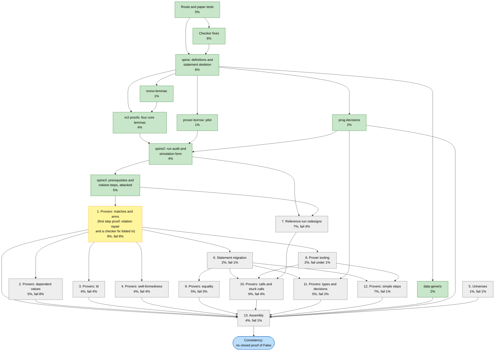

# 32. The consistency proof as work units: done and to do

Written 2026-11-19; last updated the same day, after the first checker fault was found (spine at 4032a13c). A map of the whole consistency effort (Target A of docs/18), one row per unit of work of roughly one agent's size. The plan itself is docs/18; the detailed record of the Lean development is docs/31 on the `spine` branch.

The numbers are estimates by the orchestrating session, not measurements.

- **P(failure)** is the chance the unit cannot be finished on the current plan: it needs a language feature redesigned, or a different proof architecture. Two outcomes count as success, because the work continues as planned after them. One is a tweaked statement: a lemma restated, a hypothesis added or a model definition repaired, the claim staying true in spirit. The other is a local checker fix: one rule tightened so that a class of wrongly accepted programs is rejected, as when a stuck block's arm was forbidden to return a borrow of a place the block takes by move.
- **Time** is the unit's share of all the effort the consistency proof needs. The column sums to 100% over both tables: about 36% is done and 64% remains.
- **The set of rows is fixed.** When a piece of work turns out bigger than estimated, or needs a repair or a fix nobody planned, that work is folded into the row it was done in service of, and the row's time and risk are re-estimated. No row is added for it.

## Done (36%)

| Work unit | What it contains | P(failure) | Time |
|---|---|---|---|
| Route and paper tests (`model-slice`, `model-slice-lean`, and the work behind docs/23, 25, 26 and 27) | Chose the meaning-preservation route. Showed the set model exists on a slice. Showed each old proof of `False` is a failed step. Audited every checker decision. Worked a higher-order slice. | done | 5% |
| Checker fixes (`etaboom-fix`, `bot-conv-fix`, `pisort-fix`, the join-drop change, and three later fixes) | Fixed accepted programs that proved `False` or went wrong, so that the theorem is true of the checker. | done | 6% |
| `spine` (first lead) | Lean definitions of a state's meaning and the reference run. Skeleton of 73 step statements and the final assembly, all unproved. | done; many statements later found false | 6% |
| `data-generic` | The model of user-defined data types, for any declaration. | done | 2% |
| `mono-lemmas` | Monotonicity lemmas for the reference run. | done | 1% |
| `prog-decisions` | The meaning of a whole program, and the checker's syntactic decisions packaged for the model. Found the function-sort bug. | done | 2% |
| `m2-proofs` | The four core lemmas: substitution and congruence, for values and for runs. No `sorry`. | done | 4% |
| `prover-borrow` | Pilot prover on the borrow steps. It tested the statement form, not the proofs. | done as a pilot; proofs not closed | 1% |
| `spine2` | Compared the reference run with the checker case by case: 16 differences, 11 fixed. Refuted the old statement form and introduced the simulation form. | done | 4% |
| `spine3`: prerequisites and riskiest steps, attacked | The two lemmas the statement migration waited on, then attacks on the two steps judged riskiest, the drop at the join and `Id`. An attack here means reading the statement against the checker from a related state and checking counterexamples in Lean; it is NOT a proof, and both steps are still `sorry`. Found and fixed: five faults of the simulation relation (it did not compare function shapes; it asked for a renaming of labels that cannot exist after a private copy; it compared states by an order where it needed equality; and two more), six faults of the model (among them: a partly moved value was a member of no type; reading one field ended a borrow of another; `Id` compared re-pointed borrows at untyped written values), and statement faults (the `Id` and `Eq` statements were satisfied by any wrong witness). Well-formedness gained a clause: no stored type or record holds a loan. One judgement made by reading was wrong: the gap at the join that was called harmless is where the checker fault of row 1 below was then found. | done; no checker change | 5% |

Not counted, because they are off the consistency path: `id-audit` and `subst-survey` (the dropped `Id` target), `runtime-j` (type safety), `paper-claims` and `docs18-sync` (document upkeep).

## To do (64%)

No step lemma is proved yet: every one of the 78 statements is still `sorry`. What is done so far is definitions, the four core lemmas, and attacks that corrected the statements.

Rows are in the order the units will be taken: the highest P(failure) for the least time, so that risk comes forward, except that the row already running stays first and the three units every later prover needs (migration, redesigns, tooling) come before the provers that need them.

| # | Work unit | What it contains | P(failure) | Time |
|---|---|---|---|---|
| 1 | Provers: matches and arms (running) | The drop at the join, splitting on an unknown, and leaving an arm. The drop at the join is first, as the first proof of any step in the simulation form: it tests the form itself. Work folded in so far, all in service of that proof. (a) A repair to the simulation relation so that a read is determined: a witness clause saying every borrow the reference's read of a place depends on is one the checker's own access ends, or one the checker ended early. A first repair was chosen and refuted the same day. Done by `spine4`. (b) A checker fault the proof attempt found: at the generic call a borrow variable can hold ⊥ because its borrow was ended early, which an instance need not share; the join read that ⊥ as "moved" and dropped nothing through it, so an accepted function (`EJ`, in `ochr/core/probes/d90/`) fails on a closed call. No route from it to a proof of `False` is known. A second fault with the same cause was found the same day: a rule on `Id` about when a borrow ends passes at the generic call and fails at an instance (`EI`). A narrow fix for the first (reject a drop through a dead borrow) was started and is parked on branch `d90-join-dead-borrow`, because both faults have one root: each run discovers afresh when a borrow ends, the generic run over-approximating and an instance being precise. (c) The redesign that removes the root, being assessed now by `static-ends`: when a borrow ends becomes a decision every run takes the same way, from syntax and declared types, as the drop at the join did for moves and as Rust does. A call that returns a borrow lends every place it borrowed whether it computes or is stuck, and a match on a known constructor treats outer places as the stuck match would. If it holds, the simulation relation loses its hardest part (the set of early-ended borrows, the witness clause and the lemmas around them), and the proof plan is re-made on the simpler relation. (d) The proof itself, by `spine4`, waiting on (c); its current plan is in docs/31, D28. | 8% | 9% |
| 2 | Provers: dependent values | Give a partly opened dependent value a meaning in the reference run, which it lacks today, so the step can be stated. Then prove or refute that membership is restored when a value whose type depends on its own fields is made whole again, under every future of the parts still lent. One of the old proofs of `False` lived here. | 8% | 5% |
| 3 | Provers: `Id` | Prove the corrected statements: `Id` observes every place either side can write, and its computing to a conjunction over those places keeps the meaning. | 4% | 4% |
| 4 | Provers: well-formedness | The borrow discipline is preserved by every step, including the new clause that no stored type or record holds a loan. | 4% | 4% |
| 5 | Universes | Deciding which statement Lean can prove over all programs. The bounded-levels statement is what the Lean development already builds; the open part is whether a uniform statement is provable (about 40% that it is not, which is a tweak, not a failure). | 1% | 1% |
| 6 | Statement migration | Move the remaining step statements to the simulation form: reads, borrows, assignments, access, drops, calls, `J`, closing off and the tail forms. The eval forms, matches, observation and `Eq` are done. | 1% | 2% |
| 7 | Reference-run redesigns | The remaining open differences from the checker, the comparison at other futures, and restricting the claim about untyped runs. The differences that matter most: the result of a call loses its function shape, so the reference cannot call a function returned by a call, or a parameter whose type is computed by a call (`f : Fn(Nat)`, the ordinary predicate idiom, which the checker accepts); and a proof has no type in the reference, so a constructor whose type parameter is solved by a proof field fails. Until these land, the mechanised theorem is false on such programs. A design for the call cases exists (docs/31, D22). | 4% | 7% |
| 8 | Prover tooling | A shared library about positions in a state, and the standard prover brief. | under 1% | 2% |
| 9 | Provers: equality | Conversion, `Eq` and `J` computing, and rewriting. | 3% | 5% |
| 10 | Provers: calls and stuck calls | Calls, closing a stuck call into a sealed program, re-running one, and the label-renaming lemma. | 4% | 9% |
| 11 | Provers: types and decisions | The model reads types and syntactic decisions the same way as the checker (18 statements). | 2% | 5% |
| 12 | Provers: simple steps | Borrow primitives, substitution, plain evaluation, tail forms. | 1% | 7% |
| 13 | Assembly | The top-level theorems, closing the induction, and the data model for a whole program. | 1% | 4% |

## Reading the risk column

A unit fails only if it cannot be finished on the current plan. Restating a lemma, repairing a model definition and tightening one checker rule are all successes: the proof goes ahead as planned after each. Nearly every refutation so far has ended in one of the first two, and the accepted proofs of `False` found earlier ended in the third.

- **Chance at least one remaining unit needs a local checker fix** (a success): about 65%. One has been found so far, on 2026-11-19: the join through a dead borrow, folded into row 1.
- **Chance at least one remaining unit fails**, so that a feature is redesigned or part of the proof is re-planned: about 30%. The rows are not independent (a fault in the simulation relation would hit several at once), so this is less than the rows multiplied out.
- **Chance the route itself fails**, so that meaning preservation has to be abandoned: about 7%.
- **Riskiest rows:** dependent values, where one of the old `False` proofs lived; then matches and arms, because it holds the first step proof: no step has been proved in the simulation form yet, and an earlier pilot under the old form closed nothing.

## Design changes awaiting acknowledgement

Changes to the language or the checker made in service of the proof. Each stays here until the user has acknowledged it; none waits on that.

- **Borrow ends become a decision every run shares** (proposed by the user 2026-11-19; viability check and prototype running on branch `static-ends`). Programs that rely on the machine knowing, at known arguments, which place a returned borrow really points to become rejected, as in Rust. Not landed.

## Design questions to ask before each risky unit

The bar is "as good as Rust for borrowing, as good as Lean for proving". Where a unit is hard because the design is more precise than that, the design is questioned before the proof is attempted.

- **Matches and arms (row 1):** asked, above.
- **Dependent values (row 2):** the difficulty is a value whose later fields' types depend on an earlier field that is lent or half-written. Before the unit starts: which case studies need a field that other fields' types depend on to be lent across a call, and would requiring such a field to be replaced whole, not lent, lose any of them?
- **`Id` (row 3):** its rules about when a borrow ends (a side may not end a borrow held outside it) exist because sides run on private copies. Once ends are a shared decision, check which of those rules are still needed.

## Dependencies

An arrow from X to Y means Y builds on X. Green is done, yellow is running, grey is to do. The diagram shows only what builds on what; the order the units are taken in is the table's. Everything left builds on row 1, because it holds the first step proof: the first test that a step can actually be proved in this form.

