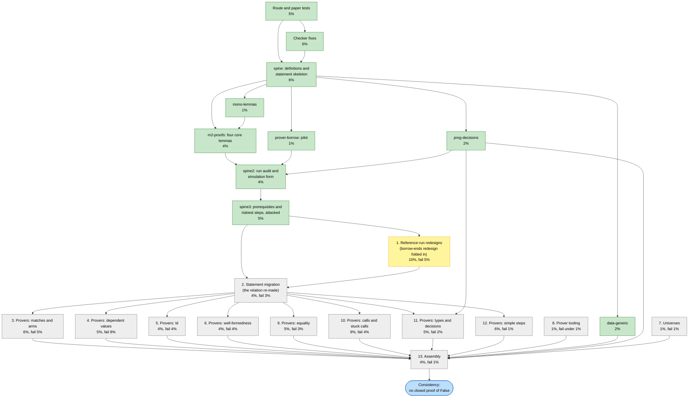

# 32. The consistency proof as work units: done and to do

Written 2026-11-19; last updated the same day, after both checker changes landed on main (9c78a376). A map of the whole consistency effort (Target A of docs/18), one row per unit of work of roughly one agent's size. The plan itself is docs/18; the detailed record of the Lean development is docs/31 on the `spine` branch.

The numbers are estimates by the orchestrating session, not measurements.

- **P(failure)** is the chance the unit cannot be finished on the current plan: it needs a language feature redesigned, or a different proof architecture. Two outcomes count as success, because the work continues as planned after them. One is a tweaked statement: a lemma restated, a hypothesis added or a model definition repaired, the claim staying true in spirit. The other is a local checker fix: one rule tightened so that a class of wrongly accepted programs is rejected, as when a stuck block's arm was forbidden to return a borrow of a place the block takes by move.
- **Time** is the unit's share of all the effort the consistency proof needs. The column sums to 100% over both tables: about 36% is done and 64% remains.
- **The set of rows is fixed.** When a piece of work turns out bigger than estimated, or needs a repair or a fix nobody planned, that work is folded into the row it was done in service of, and the row's time and risk are re-estimated. No row is added for it.

## Done (36%)

| Work unit | What it contains | P(failure) | Time |
|---|---|---|---|
| Route and paper tests (`model-slice`, `model-slice-lean`, and the work behind docs/23, 25, 26 and 27) | Chose the meaning-preservation route. Showed the set model exists on a slice. Showed each old proof of `False` is a failed step. Audited every checker decision. Worked a higher-order slice. | done | 5% |
| Checker fixes (`etaboom-fix`, `bot-conv-fix`, `pisort-fix`, the join-drop change, and three later fixes) | Fixed accepted programs that proved `False` or went wrong, so that the theorem is true of the checker. | done | 6% |
| `spine` (first lead) | Lean definitions of a state's meaning and the reference run. Skeleton of 73 step statements and the final assembly, all unproved. | done; many statements later found false | 6% |
| `data-generic` | The model of user-defined data types, for any declaration. | done | 2% |
| `mono-lemmas` | Monotonicity lemmas for the reference run. | done | 1% |
| `prog-decisions` | The meaning of a whole program, and the checker's syntactic decisions packaged for the model. Found the function-sort bug. | done | 2% |
| `m2-proofs` | The four core lemmas: substitution and congruence, for values and for runs. No `sorry`. | done | 4% |
| `prover-borrow` | Pilot prover on the borrow steps. It tested the statement form, not the proofs. | done as a pilot; proofs not closed | 1% |
| `spine2` | Compared the reference run with the checker case by case: 16 differences, 11 fixed. Refuted the old statement form and introduced the simulation form. | done | 4% |
| `spine3`: prerequisites and riskiest steps, attacked | The two lemmas the statement migration waited on, then attacks on the two steps judged riskiest, the drop at the join and `Id`. An attack here means reading the statement against the checker from a related state and checking counterexamples in Lean; it is NOT a proof, and both steps are still `sorry`. Found and fixed: five faults of the simulation relation (it did not compare function shapes; it asked for a renaming of labels that cannot exist after a private copy; it compared states by an order where it needed equality; and two more), six faults of the model (among them: a partly moved value was a member of no type; reading one field ended a borrow of another; `Id` compared re-pointed borrows at untyped written values), and statement faults (the `Id` and `Eq` statements were satisfied by any wrong witness). Well-formedness gained a clause: no stored type or record holds a loan. One judgement made by reading was wrong: the gap at the join that was called harmless is where the checker fault of row 1 below was then found. | done; no checker change | 5% |

Not counted, because they are off the consistency path: `id-audit` and `subst-survey` (the dropped `Id` target), `runtime-j` (type safety), `paper-claims` and `docs18-sync` (document upkeep).

## To do (64%)

No step lemma is proved end to end yet. The first composition is: the drop at the join for a list of places is proved from the drop of one place, which is still `sorry` (2026-11-19, `spine` 4ea3a765). That is the first evidence that the statement form supports a proof. What else is done is definitions, the four core lemmas, and attacks that corrected the statements.

**What can depend on what.** Nothing depends on a proof: once a statement is fixed, other work assumes it. Work depends only on definitions and statements. So the two rows that change definitions and statements (1 and 2) come first and everything else builds on them, and no arrow in the diagram leaves a prover row except into the assembly. Among the prover rows the order is a choice, not a dependency: the highest P(failure) for the least time first, so that risk comes forward. Matches and arms leads because it holds the first proof of any step, which is the first real test of the statement form.

| # | Work unit | What it contains | P(failure) | Time |
|---|---|---|---|---|
| 1 | Reference-run redesigns (running) | Making the model's reference run and the checker agree. Folded in, because it is the largest disagreement there was: the checker's borrow-ends redesign. Each run used to discover afresh when a borrow ends, the generic run over-approximating and an instance being precise, which gave three checker faults found on 2026-11-19 (accepted functions whose closed calls fail: `EJ`, `EI`, `G1`, in `ochr/core/probes/static-ends/`) and forced the model to carry a set of early-ended borrows. Now when a borrow ends is a decision every run takes the same way, as Rust does: a call that returns a borrow lends every place it borrowed, and a non-tail match on a known constructor treats outer places as the stuck match would (decision D90, on main since 2026-11-19 at 46dd2d9a; one existing verdict changed, which Rust also rejects). A stuck match now also touches its captures before its arms are checked (D91, on main at 9c78a376), so the generic run and an instance have the same borrows live at every point. The Lean model is rebuilt on the new checker (`spine5`): the reference run ends borrows from a table of lent places and never from meanings. Still to do here: the tail-position flag, the match entry and three kinds of deliberate borrow end in the reference run, and the older open differences. Those are: the comparison at other futures, and restricting the claim about untyped runs. The differences that matter most: the result of a call loses its function shape, so the reference cannot call a function returned by a call, or a parameter whose type is computed by a call (`f : Fn(Nat)`, the ordinary predicate idiom, which the checker accepts); and a proof has no type in the reference, so a constructor whose type parameter is solved by a proof field fails. Until these land, the mechanised theorem is false on such programs. A design for the call cases exists (docs/31, D22). | 5% | 10% |
| 2 | Statement migration | The form every step statement takes. The simulation relation is re-made on the redesign, with no set of early-ended borrows and no witness clause: the same borrows held in the same positions, lent at the same places, readings equal. Proving the first composition changed the form in four ways (a run may start from any log; a step may conclude under an extended context of unknowns; the drop's grain is a hypothesis; scope is preserved along a list). Still to do: the remaining step statements moved onto it: reads, borrows, assignments, access, drops, calls, `J`, closing off and the tail forms. The eval forms, matches, observation and `Eq` were migrated to the earlier relation and are re-stated. | 3% | 4% |
| 3 | Provers: matches and arms (running, `spine5`) | The drop at the join, splitting on an unknown, and leaving an arm. The drop at the join is the first proof attempted of any step. The first attempt, on the old checker, is what found the fault that led to the redesign in row 1. On the new checker the drop of a list of places is reduced to the drop of one place; that one is open, and needs lemmas most other steps will share (marking a part moved commutes with the meaning; ends within one access commute; the checker's and the reference's ways of finding a place agree) and a case analysis specific to how the checker finds a place that does not exist yet. | 5% | 7% |
| 4 | Provers: dependent values | Give a partly opened dependent value a meaning in the reference run, which it lacks today, so the step can be stated. Then prove or refute that membership is restored when a value whose type depends on its own fields is made whole again, under every future of the parts still lent. One of the old proofs of `False` lived here. | 8% | 5% |
| 5 | Provers: `Id` | Prove the corrected statements: `Id` observes every place either side can write, and its computing to a conjunction over those places keeps the meaning. | 4% | 4% |
| 6 | Provers: well-formedness | The borrow discipline is preserved by every step, including the clause that no stored type or record holds a loan. | 4% | 4% |
| 7 | Universes | Deciding which statement Lean can prove over all programs. The bounded-levels statement is what the Lean development already builds; the open part is whether a uniform statement is provable (about 40% that it is not, which is a tweak, not a failure). | 1% | 1% |
| 8 | Prover tooling | A shared library about positions in a state, and the standard prover brief. | under 1% | 1% |
| 9 | Provers: equality | Conversion, `Eq` and `J` computing, and rewriting. | 3% | 5% |
| 10 | Provers: calls and stuck calls | Calls, closing a stuck call into a sealed program, re-running one, and the label-renaming lemma. | 4% | 9% |
| 11 | Provers: types and decisions | The model reads types and syntactic decisions the same way as the checker (18 statements). | 2% | 5% |
| 12 | Provers: simple steps | Borrow primitives, substitution, plain evaluation, tail forms. | 1% | 5% |
| 13 | Assembly | The top-level theorems, closing the induction, and the data model for a whole program. | 1% | 4% |

## Reading the risk column

A unit fails only if it cannot be finished on the current plan. Restating a lemma, repairing a model definition and tightening one checker rule are all successes: the proof goes ahead as planned after each. Nearly every refutation so far has ended in one of the first two, and the accepted proofs of `False` found earlier ended in the third.

- **Chance at least one remaining unit needs a local checker fix** (a success): about 65%. Found so far, on 2026-11-19: three faults with one root, when a borrow ends. They were answered by the redesign in row 1, which counts as a feature redesign, not a local fix.
- **Chance at least one remaining unit fails**, so that a feature is redesigned or part of the proof is re-planned: about 30%. The rows are not independent (a fault in the simulation relation would hit several at once), so this is less than the rows multiplied out.
- **Chance the route itself fails**, so that meaning preservation has to be abandoned: about 7%.
- **Riskiest rows:** dependent values, where one of the old `False` proofs lived; then matches and arms, because it holds the first step proof: no step has been proved yet, and an earlier pilot under the old statement form closed nothing.

## Design changes awaiting acknowledgement

Changes to the language or the checker made in service of the proof. Each stays here until the user has acknowledged it; none waits on that.

- **A stuck match touches its captures before its arms are checked** (D91; on main since 2026-11-19 at 9c78a376). It removes the last point at which the generic run and an instance could have different borrows live. No existing verdict changed; three probe programs that were rejected are now accepted, as Rust accepts them (an `Id` inside a match arm reading a place a live borrow points to).
- **One-constructor matches refine in place instead of closing off** (parked on branch `eta-one-ctor`, viability unfinished). It restores Rust's precision for disjoint fields of a pair on both paths; a field read is a one-arm match today, and touches the whole value. It carries risk in the dependent-field rules.

Acknowledged: borrow ends become a decision every run shares (D90; proposed by the user and acknowledged 2026-11-19).

## Design questions to ask before each risky unit

The bar is "as good as Rust for borrowing, as good as Lean for proving". Where a unit is hard because the design is more precise than that, the design is questioned before the proof is attempted.

- **Borrow ends (row 1):** asked and answered: the redesign in row 1.
- **Matches and arms (row 3):** asked 2026-11-19, while the drop of one place was open. Part of that proof exists only because the checker has to find a place that does not exist yet (a field of an unknown pair, of a stuck value, or under a lent parent). Keeping values of one-constructor types expanded into their fields would make such places always exist, and is the parked change that also restores Rust's precision for disjoint fields. The proof lead's estimate: it would delete about a third of that one proof, and none of the lemmas that carry the risk (an access, an end, marking a part moved, the two ways of finding a place agreeing), which every other step needs anyway. Conclusion: do not make the change for the proof's sake. It stays parked, to be done for precision against Rust.
- **Dependent values (row 4):** asked 2026-11-19, with the user. The difficulty is a value whose later field's type depends on an earlier field that is lent or half-written. Conclusion, in two parts. (1) Inside a function body there is no problem to solve in the language: once such a value is open, the checker types the later field by what it holds, not by the earlier field, so its type does not follow the lent field. The model does not do this yet (it re-reads the earlier field through the borrow), and that is the fault to fix, in the model. (2) At a point where the value must be whole again (a return, a call), the checker does not require the loan ended: it checks the value with the lent part replaced by a fresh unknown of its type, so the invariant must hold whatever the borrow later writes. Requiring every loan ended there would be simpler, but it would reject accessors that return a borrow into data an invariant mentions (the examples' user-land vector, whose invariant says its first cells are full, returns a borrow into a cell's payload), and Rust has those. So the rule stays; it is also what closed the two proofs of `False` found here. The step to prove is then the natural one: a check that passes for a fresh unknown gives membership under every final content of the borrow.
- **`Id` (row 5):** its rules about when a borrow ends (a side may not end a borrow held outside it) exist because sides run on private copies. Once ends are a shared decision, check which of those rules are still needed.

## Dependencies

An arrow from X to Y means Y builds on definitions or statements that X produces. Green is done, yellow is running, grey is to do. No arrow leaves a prover row except into the assembly, because nothing depends on a proof; the order among prover rows is the table's.

